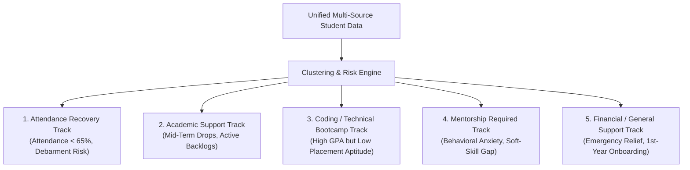

# KPMG in India - Smart Campus Analytics Platform
## AI-Powered Student Success Platform: Predict, Optimize & Improve
**Hackathon Deliverables & Pitch Documentation**

---

### Executive Overview & Challenge Alignment

Colleges generate large amounts of disparate data across attendance registers, LMS portals, internal examination records, hackathons, and placement mock drives. Stored in disconnected silos, this data is rarely used proactively.

**Smart Campus Analytics** unifies these multi-source data streams into a single **Decision Intelligence Platform**. Moving beyond passive reporting, it applies machine learning to:
1. **Predict:** Detect student attrition, academic dropouts, and placement failures early in the semester.
2. **Optimize:** Cluster students into targeted, actionable intervention tracks rather than one-size-fits-all warnings.
3. **Improve:** Empower college administrators and faculty advisors with one-click proactive interventions and "What-If" predictive simulations.

---

### Deliverable 1: The Student Success Score Formulation

The **Student Success Score** ($S \in [0, 100]$) is an explainable, weighted ensemble model synthesizing 5 multi-source vectors:

$$S = 0.30 \cdot A_{\text{cad}} + 0.25 \cdot P_{\text{lace}} + 0.20 \cdot A_{\text{ttn}} + 0.15 \cdot L_{\text{ms}} + 0.10 \cdot S_{\text{kill}}$$

| Vector Indicator | Weight | Specific Data Sources Integrated | Normalization / Scaling |
| :--- | :---: | :--- | :--- |
| **Academic Performance ($A_{\text{cad}}$)** | **30%** | Cumulative CGPA, mid-term examination scores, active course backlogs | Scaled to $0–100$; $-15$ penalty per active backlog |
| **Placement Preparedness ($P_{\text{lace}}$)** | **25%** | Campus aptitude percentile, coding round test scores, mock interviews | Combined score of quantitative aptitude & coding bench |
| **Attendance Quorum ($A_{\text{ttn}}$)** | **20%** | Physical lecture & lab attendance registers | $\text{Attendance } \% \times 1.0$; steep penalty if $< 65\%$ |
| **LMS Engagement ($L_{\text{ms}}$)** | **15%** | Weekly login frequency, assignment turnaround %, forum participation | Activity index $(0–100)$ based on turnaround cadence |
| **Skills & Co-Curricular ($S_{\text{kill}}$)** | **10%** | Soft-skill evaluation, hackathon wins, industrial internships | Peer & faculty rubric rating $(0–100)$ |

#### Risk Tier Stratification
* **Safe Tier (Score $\ge 75$):** On track for honors and Tier-1 corporate placement.
* **Moderate Risk Tier ($50 \le \text{Score} < 75$):** Early warning stage; automated LMS and SMS nudges dispatched.
* **High-Risk / Critical Tier ($\text{Score} < 50$):** High danger of semester debarment or corporate placement failure; triggers mandatory 1-on-1 faculty intervention.

$$\text{Risk Score} = 100 - \text{Success Score}$$

---

### Deliverable 2: Explainable AI (XAI) Attribution Model (Bonus Feature)

Traditional machine learning algorithms act as "black boxes," leaving faculty unsure of why a student was flagged. 

Our platform integrates **SHAP (SHapley Additive exPlanations)** feature attribution to quantify the exact point contributions for every student:

$$\text{Success Score} = \text{Campus Base Mean} + \sum_{i=1}^{n} \phi_i$$

* **Positive Drivers ($\phi_i > 0$):** Highlight strengths (e.g., `+18 pts Strong Core GPA`, `+12 pts Hackathon Champion`).
* **Risk Penalties ($\phi_i < 0$):** Pinpoint specific deficits (e.g., `-24 pts Severe LMS Inactivity (21 Days)`, `-26 pts Attendance Below 65% Threshold`).
* **Conversational AI Summary:** Generates a plain-English diagnosis answering *"Why was this student flagged?"* for non-technical faculty members.

---

### Deliverable 3: Targeted Student Segmentation (Bonus Feature)

Rather than treating all at-risk students identically, our platform segments them into **5 Actionable Intervention Tracks**:

1. **Attendance Recovery Track:** Attendance below $65\%$ minimum threshold. Action: *Attendance Recovery Makeup Contract & Dean Hearing*.
2. **Academic Support Track:** High failure risk in core theoretical courses. Action: *Peer Tutoring & Remedial Assignment Modules*.
3. **Coding/Technical Bootcamp Track:** Academically sound ($>8.0$ CGPA) but failing coding benchmarks. Action: *Placement Cell Fast-Track Bootcamp*.
4. **Mentorship Required Track:** Communication anxiety in mock corporate interviews. Action: *1-on-1 Alumni & KPMG Mentoring Sessions*.
5. **Financial/General Support Track:** Welfare assistance, fee deferral, or transition counseling for first-year undergraduates.

---

### Deliverable 4: The 5-Slide Hackathon Pitch Deck Script

#### Slide 1: The Campus Crisis & Our Vision
* **Headline:** Disconnected Data vs. Proactive Decision Intelligence.
* **The Problem:** Colleges produce massive data in silos. By the time a student fails or gets debarred, it is already too late.
* **Our Solution:** An AI-powered Student Success Platform that integrates Academic, LMS, Attendance, and Placement records to predict, optimize, and intervene before exams.

#### Slide 2: Unified Multi-Source Data Architecture
* **Headline:** Single Pane of Glass for Campus Leadership.
* **Key Point:** 5 Data streams integrated in real time.
* **KPMG Metric:** $1,240$ students unified across 4 engineering departments, identifying $168$ critical at-risk students ($13.5\%$) before end-semester exams.

#### Slide 3: The Explainable Student Success Score
* **Headline:** Moving Beyond the Black Box.
* **Key Point:** Our formula is transparent and weighted ($30\%$ Academic, $25\%$ Placement, $20\%$ Attendance, $15\%$ LMS, $10\%$ Skills).
* **Explainability Demo:** Show SHAP positive boosts (`+18 pts`) and penalty deductions (`-24 pts`) with the "Why was this student flagged?" card.

#### Slide 4: Targeted Segmentation & Decision Intelligence
* **Headline:** Tailored Actions, Not Blanket Warnings.
* **Key Point:** Show the 5 Intervention Tracks (Attendance Recovery, Academic Support, Coding Bootcamp, Mentorship, Financial Support).
* **Live Action:** One-click intervention dispatch with live audit trails.

#### Slide 5: The "What-If" Predictive Simulator & Impact
* **Headline:** Predict & Optimize the Future.
* **Live Demo:** Demonstrate the simulator: *"If Rohan attends 8 makeup sessions and completes his LMS assignments, his projected score increases from 42% to 68%, moving him out of danger."*
* **Closing:** Scalable, enterprise-ready, and directly aligned with KPMG's digital advisory vision.

---

### Evaluation Criteria Verification Checklist (100 Points)

| KPMG Criterion | Points | Where Implemented in Platform |
| :--- | :---: | :--- |
| **Data Integration & Analysis** | **30%** | Unified model combining CGPA, attendance registers, LMS turnaround, and placement aptitude in `mockData.js`. |
| **Success Score & Risk Identification** | **25%** | Mathematical 0–100 formulation with clear Safe, Moderate, and Critical risk tiers and color-coded meters. |
| **Dashboard & Visualization** | **25%** | Recharts Bar Charts, Area trajectories, 5-Axis Radar Chart, interactive data tables, and quick-profile modals. |
| **Problem Understanding** | **10%** | Addressed real Indian campus realities (placement gaps, attendance thresholds, debarment rules). |
| **Presentation & Demo** | **10%** | Live demo preview (`preview.html`), 1-click persona testing, and this presentation slide script. |
| **Bonus: Student Segmentation** | **+5 Pts** | 5 Targeted segmentation tracks with urgency meters and cohort triage filters. |
| **Bonus: Explainable AI** | **+5 Pts** | SHAP feature attribution weights and conversational "Why was this student flagged?" diagnosis. |
