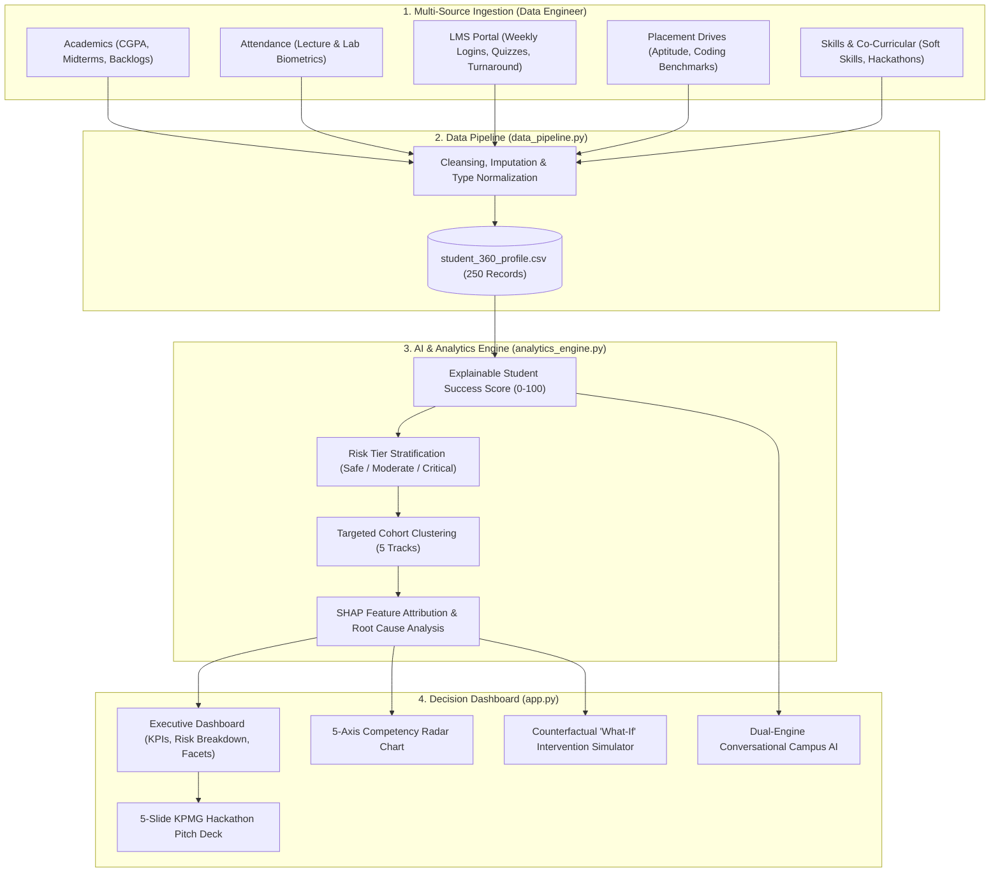

# 🎓 KPMG Smart Campus Analytics Platform
## AI-Powered Student Success & Decision Intelligence Platform
**HacXLerate 2026 — Round 1 Campus Hackathon Submission**

[](https://share.streamlit.io)


---

## 📌 Executive Summary & Problem Context

Higher education institutions generate massive amounts of student telemetry across disparate sources: attendance biometrics, learning management system (LMS) logs, internal examinations, competitive coding platforms, and placement mock drives. 

Currently, these records reside in disconnected operational silos. Consequently:
* **Late Attrition Detection:** Attrition, academic failure, and exam debarments are only discovered after semester end-exams when remediation is impossible.
* **Placement Gaps:** Students with strong theoretical CGPA (>8.0) quietly fail early corporate placement rounds due to unmonitored deficits in Data Structures & Algorithms (DSA) or behavioral interview anxiety.
* **One-Size-Fits-All Warnings:** Traditional warnings do not prescribe actionable paths tailored to individual root causes.

### 💡 The Solution: Smart Campus Analytics
**Smart Campus Analytics** transforms passive reporting into proactive **Decision Intelligence**:
1. **Predict:** Accurately forecasts academic failure, statutory exam debarment (<65% attendance), and campus recruitment rejection weeks in advance.
2. **Optimize:** Dynamically clusters at-risk students into **5 Tailored Intervention Tracks** rather than generic reprimands.
3. **Intervene & Simulate:** Provides academic leadership with a counterfactual **Predictive 'What-If' Simulator**, automated audit logs, and an **Explainable AI (SHAP)** engine answering *"Why was this student flagged?"*.

---

## 🏛️ System Architecture & Data Flow



---

## 📐 Deliverable 1: Explainable Success Score Formulation (25% Weight)

The **Student Success Score** ($S \in [0, 100]$) is an explainable composite formulation synthesizing 5 weighted pillars:

$$S = 0.30 \cdot A_{\text{cad}} + 0.25 \cdot P_{\text{lace}} + 0.20 \cdot A_{\text{ttn}} + 0.15 \cdot L_{\text{ms}} + 0.10 \cdot S_{\text{kill}}$$

$$\text{Risk Score} = 100 - \text{Success Score}$$

| Vector Indicator | Weight | Data Sources Integrated | Scaling & Penalty Logic |
| :--- | :---: | :--- | :--- |
| **Academic Performance ($A_{\text{cad}}$)** | **30%** | Cumulative CGPA, mid-term examination marks, active backlogs | Normalized to $0–100$; $-15\text{ pts}$ deduction per active course backlog |
| **Placement Preparedness ($P_{\text{lace}}$)** | **25%** | Aptitude benchmark percentile, coding assessment score, mock interviews | $\text{Aptitude} \times 0.4 + \text{Coding} \times 0.4 + \text{Mock HR} \times 0.2$ |
| **Attendance Quorum ($A_{\text{ttn}}$)** | **20%** | Physical lecture & lab attendance registers | $\text{Attendance } \% \times 1.0$; statutory warning below $75\%$, debarment hazard below $65\%$ |
| **LMS Engagement ($L_{\text{ms}}$)** | **15%** | Portal login cadence, assignment turnaround %, discussion forum activity | $50\text{ pts}$ login index + $50\text{ pts}$ on-time submission rate |
| **Skills & Co-Curricular ($S_{\text{kill}}$)** | **10%** | Technical programming rubric, corporate soft skills, hackathon badges | Peer & faculty rubric rating $(0–100)$ |

### 🚦 Risk Tier Stratification
* 🟢 **Safe Tier ($S \ge 75$):** Student is thriving; proactive fast-tracking for Tier-1 corporate placement drives and fellowships.
* 🟡 **Moderate Risk Tier ($50 \le S < 75$):** Early warning stage; automated LMS and SMS nudges dispatched.
* 🔴 **Critical / High-Risk Tier ($S < 50$):** Imminent danger of semester debarment or corporate rejection; mandates immediate 1-on-1 faculty intervention.

---

## 🎯 Deliverable 2: Targeted Student Segmentation (5 Tracks)

Rather than issuing generic warnings, students are clustered into **5 actionable tracks**:

1. **⏰ Attendance Recovery Track:** Attendance below $65\%$. Action: *Attendance Makeup Contract & Dean Hearing*.
2. **📖 Academic Support Track:** High failure risk in core theoretical courses. Action: *Remedial Tutoring & Lab Catch-Up*.
3. **💻 Coding / Technical Bootcamp Track:** High CGPA ($>7.5$) but low placement coding scores ($<60$). Action: *Placement Cell Fast-Track DSA Masterclass*.
4. **👤 Mentorship Required Track:** Communication anxiety in mock corporate interviews. Action: *1-on-1 Alumni & KPMG Mentoring Sessions*.
5. **🤝 Financial / General Support Track:** Emergency relief, fee clearance assistance, or first-year university adjustment counseling.

---

## 🔍 Deliverable 3: Explainable AI (XAI) & SHAP Drivers

Traditional machine learning risk flags act as black boxes. Our platform decomposes each score into explicit, quantifiable **SHAP-inspired feature attribution vectors**:
* **Positive Drivers ($\phi > 0$):** e.g., `+18 pts High Academic CGPA (8.75)`, `+14 pts Exemplary Attendance (94%)`.
* **Risk Deductions ($\phi < 0$):** e.g., `-26 pts Severe Attendance Deficit (64%)`, `-20 pts Placement Coding Lag (48%)`.
* **Conversational Diagnostic Synthesis:** Generates a plain-English explanation answering *"Why was this student flagged?"* for non-technical faculty deans.

---

## ⚡ Deliverable 4: Predictive Counterfactual 'What-If' Simulator

Academic leadership can test interventions mathematically before committing campus resources:
* **Attendance Recovery Makeup (+12%):** Models attendance improvement and projected score delta.
* **Coding Bootcamp (+28%):** Simulates technical score uplift for candidates like Ananya Iyer.
* **LMS Catch-Up (+25%):** Models assignment submission catch-up.
* **1-on-1 Mentorship (+15%):** Models soft-skill improvement.

The 5-axis competency radar chart re-renders dynamically against campus benchmarks in real time.

---

## 🤖 Deliverable 5: Dual-Engine Conversational Campus AI

An enterprise AI assistant supporting natural language inquiries:
* **Local Data Analyst Engine (Zero Failure / Offline):** Always active with zero API dependencies. Instantly processes queries like:
  * *"Which students are at High Risk?"*
  * *"How can I improve Rohan Verma's score?"*
  * *"Show students with placement and coding gaps"*
  * *"Give me a summary of Computer Science department risk"*
* **Live Google Gemini 1.5 Flash:** Optional integration via an API key input in the sidebar for real-time generative responses.

---

## 💻 Repository File Structure

```
kmpg_smart_campus/
├── app.py                         # Unified Streamlit platform (Matching KPMG Executive UI)
├── analytics_engine.py            # AI scoring, risk stratification, 5 clusters, SHAP attribution
├── data_pipeline.py               # Multi-source data loader & cleansing pipeline
├── student_360_profile.csv        # Master dataset with 250 multi-pillar student records
├── preview.html                   # High-fidelity React/Tailwind design system reference
├── requirements.txt               # Reproducible Python dependencies
├── KPMG_SUBMISSION_AND_SLIDES.md  # Complete 5-slide pitch script & evaluation rubric
├── TEAM_MERGE_GUIDE.md            # Team roles and integration architecture
└── README.md                      # Comprehensive project documentation
```

---

## 🚀 How to Run Locally

### 1. Clone the Repository
```bash
git clone https://github.com/your-team/kpmg-smart-campus-analytics.git
cd kpmg-smart-campus-analytics
```

### 2. Install Dependencies
```bash
pip install -r requirements.txt
```

### 3. Launch the Application
```bash
streamlit run app.py
```
Open **`http://localhost:8501`** in your browser.

---

## 🌐 1-Click Deployment (Streamlit Cloud / byteXL Nimbus)

1. Push this repository to GitHub:
   ```bash
   git init
   git add .
   git commit -m "feat: complete KPMG Smart Campus Analytics platform"
   git push -u origin main
   ```
2. Navigate to [share.streamlit.io](https://share.streamlit.io).
3. Connect your repository and select `app.py` as the main entry point.
4. Click **Deploy!** The application will build automatically with `requirements.txt`.

---

## 🏆 HacXLerate 2026 Evaluation Alignment (100 Points)

| Evaluation Parameter | Weight | Implementation in Platform |
| :--- | :---: | :--- |
| **Data Integration & Analysis** | **30%** | Unified 7-pillar telemetry ingestion across 250 students in `data_pipeline.py`. |
| **Success Score & Risk Identification** | **25%** | Mathematical $0–100$ formula, 3 risk tiers, and color-coded meters in `analytics_engine.py`. |
| **Dashboard & UX Quality** | **25%** | Professional KPMG corporate design, interactive Plotly charts, 5-axis radar chart, filterable directory with CSV export. |
| **Problem Understanding** | **10%** | Addressed real campus realities: exam debarment thresholds, placement coding lags, NAAC retention factors. |
| **Presentation & Live Demo** | **10%** | Interactive presets (`🔴 High Risk`, `🟡 Placement Gap`, `🟢 Star Student`), 5-slide pitch deck embedded inside app. |
| **Bonus: Targeted Segmentation** | **+5 Pts** | 5 Actionable Intervention Tracks with audit action triggers. |
| **Bonus: Explainable AI (XAI)** | **+5 Pts** | SHAP-inspired feature attribution with "Why was this student flagged?" synthesis. |

---

*Built with passion for **HacXLerate 2026** by Team Smart Campus.*

