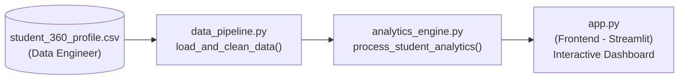

# KPMG Smart Campus Analytics - Team Integration & Merge Guide

This document explains how our team's 4 roles connect their code into a single unified deployment for KPMG judges.

---

### 🏛️ Team Architecture & File Map

```
smart-campus-analytics/
├── data_pipeline.py          # Data Engineer: Loads & cleans multi-source student records
├── student_360_profile.csv   # Data Engineer: Cleaned master dataset (Academics, Attendance, LMS, etc.)
├── analytics_engine.py       # AI & Analytics Lead: Calculates success_score, risk_flags & segments
├── app.py                    # Frontend Developer: Visual UI (KPI cards, charts, filters, radar, What-If)
├── requirements.txt          # Backend & DevOps: Reproducible Python environment
└── README.md                 # Project documentation & KPMG Hackathon Pitch
```

---

### 🔄 Data & Function Flow (How the pieces connect)



1. **Step 1 (Data Engineer):**
   - Place `student_360_profile.csv` in the root folder.
   - `data_pipeline.py` exposes `load_and_clean_data()`, returning a cleansed `pandas.DataFrame`.

2. **Step 2 (AI & Analytics Lead):**
   - `analytics_engine.py` imports the DataFrame from `data_pipeline.py`.
   - Adds calculated columns:
     - `success_score` (0–100)
     - `risk_score` (100 - success_score)
     - `academic_risk` (`True` / `False`)
     - `placement_risk` (`True` / `False`)
     - `risk_tier` (`Low`, `Medium`, `High`)
     - `cluster_segment` (*Attendance Recovery, Academic Support, Coding Bootcamp, Mentorship, Financial*)
     - `get_score_drivers(row)`: SHAP-inspired positive and risk point drivers.

3. **Step 3 (Frontend Developer - You):**
   - `app.py` imports `load_and_clean_data()` and `process_student_analytics()`.
   - Renders:
     - **KPI Cards** (Total, At-Risk, High-Risk, Interventions).
     - **Interactive Plotly Risk Distribution** (donut & grouped bars).
     - **5 Targeted Segmentation Tracks**.
     - **Searchable & Filterable Table** with CSV export.
     - **5-Axis Competency Radar Chart**.
     - **Explainable AI Diagnosis** (*"Why was this student flagged?"*).
     - **Predictive What-If Intervention Simulator** (real-time score recalculation).
     - **Embedded 5-Slide Pitch Deck**.

4. **Step 4 (Backend & DevOps):**
   - Uses `requirements.txt` to deploy the repository to **Streamlit Cloud**, **Render**, or **byteXL Nimbus**.

---

### 🚀 Running the Unified App Locally

```bash
# 1. Install dependencies
pip install -r requirements.txt

# 2. Run the Streamlit application
streamlit run app.py
```

The app will launch at `http://localhost:8501`.

---

### 🌐 Deploying to Streamlit Cloud (1-Click)

1. Push all files to a GitHub repository:
   ```bash
   git init
   git add .
   git commit -m "feat: complete KPMG Smart Campus Analytics platform"
   git push -u origin main
   ```
2. Go to [share.streamlit.io](https://share.streamlit.io).
3. Connect your GitHub repository.
4. Set Main file path to: `app.py`.
5. Click **Deploy!** Streamlit Cloud will automatically install `requirements.txt` and generate your Live URL to submit to KPMG judges.
